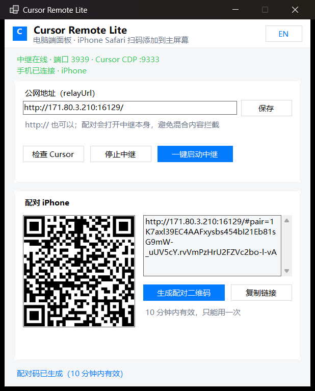
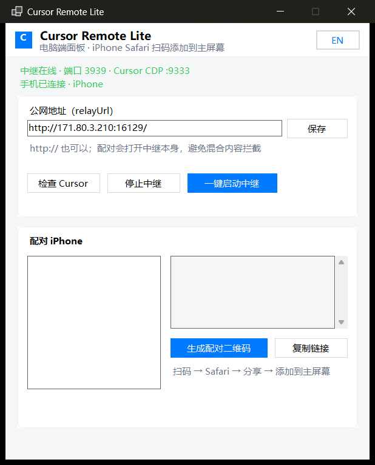

[中文](README.md) | **English**

# Cursor Remote Lite

Use your **desktop Cursor from your phone**: chat with the Agent, approve steps, answer questions, switch windows / models, preview files. Free, MIT, self-hosted.

This fork focuses on a **Windows desktop panel (`.exe`)** plus a fixed tunnel such as [ChmlFrp](https://www.chmlfrp.net/) / frp. iPhone uses Safari → **Add to Home Screen** (any mobile browser PWA works too). Inspired by [len5ky/CursorRemote](https://github.com/len5ky/CursorRemote).

<p align="center"></p>

## Screenshots

| Desktop panel | Pairing | Chat | Windows |
|:-:|:-:|:-:|:-:|
|  |  |  |  |

## Quick start (Windows + iPhone)

```powershell
git clone https://github.com/vce27/cursor-remote-lite.git
cd cursor-remote-lite
npm install
npm run desktop:build
npm run desktop
```

1. Map your frp public port to `127.0.0.1:3939`.
2. Paste the public URL into **relayUrl** → Save → **Check Cursor** → **Start Relay**.
3. **Make Pair QR** → scan with iPhone → Safari → Share → **Add to Home Screen**.
4. Daily: open the panel → Start Relay → open the phone home-screen icon.

`http://` is fine for frp: pairing opens the relay itself (avoids mixed-content issues).

If the phone stays on “Connecting…” / “Cursor not linked”, the relay may be up but Cursor was not started with a debug port — click **Check Cursor** on the panel (or run `scripts/start-cursor.ps1`).

## How it works

```
Phone PWA  --WebSocket-->  frp / Cloudflare  -->  Node relay :3939  --CDP-->  Cursor
```

## Commands

| Command | Purpose |
| --- | --- |
| `npm run desktop` / `desktop:build` | Launch / build the WinForms panel |
| `npm run phone` | CLI: Cursor CDP + relay |
| `npm run public:relay` | Relay only (`CR_RELAY_URL`) |
| `npm run public` | Cloudflare quick tunnel |
| `npm run pair` / `devices` / `2fa` | Pairing & 2FA |
| `./scripts/start-cursor.sh` | macOS: relaunch Cursor with CDP |
| `./scripts/service.sh install` | macOS LaunchAgent |

## Keep the PC awake

The relay dies if the machine sleeps. Allow screen-off / lock, but set sleep to **Never** on AC power.

## Security

Pairing links expire in 10 minutes and are one-time. Optional TOTP via `npm run 2fa`. Do not share pairing links publicly.

## License

MIT
